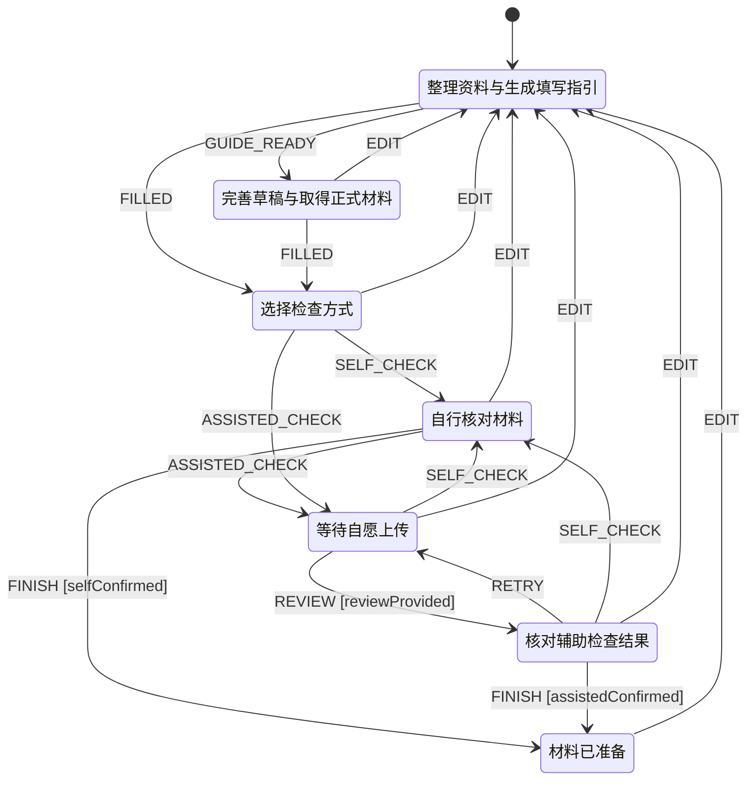

# 非配偶担保人签署的担保函任务流程

由实际任务配置生成，不包含申请人数据。

任务 ID：`sponsorship_letter`；流程：`draft-v1`；版本：`sponsorship_letter-v1`。

完成后仍可 EDIT 返回准备步骤；原检查及完成确认同时清除。

## 检查项目

- 担保人和资助安排一致
- 申请、行程及担保内容已核对
- 担保人本人已签署（由用户本人确认）
